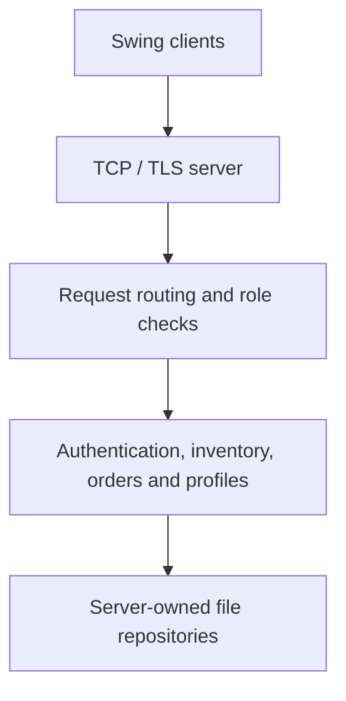

# SupplyGo

A Java desktop client and concurrent TCP server for supply-chain operations. Built as a team project for **EC5205 — Operating System and Network Programming, University of Ruhuna**.

**Status: in development.** The repository includes working modules and automated test code; delivery routing and UDP chat remain planned.

[Getting started](docs/GETTING_STARTED.md) · [TLS and accounts](docs/AUTHENTICATION.md) · [Protocol](docs/NETWORK_PROTOCOL.md)

## Current implementation

| Area | Implemented scope |
| --- | --- |
| Networking | TCP client/server, concurrent connection handling and structured request/response messages |
| Desktop client | Swing interface with background network operations |
| Authentication | TLS sign-in, supplier/seller registration, server-side roles and persistent accounts |
| Inventory | Product management, stock batches and FIFO withdrawals |
| Orders | Stock reservation, approval, fulfilment, cancellation and role-based access |
| Business profiles | Supplier/seller profiles and role-filtered manager directories |
| Storage | Server-owned file repositories for accounts, inventory/orders and business profiles |
| Tests | JUnit protocol, service, authentication and network integration tests |

See the module guides for supported operations and limitations. Source code and tests are present; this overview does not certify production readiness.

## Build and run

Requirements: **JDK 25**, **Maven 3.9+**, and a graphical desktop for the Swing client.

```bash
git clone https://github.com/uvinN20/SupplyGo.git
cd SupplyGo
mvn clean verify
```

The packaged application is `target/supplygo-0.1.0-SNAPSHOT.jar`.

For a basic local connection demonstration, run these in separate terminals:

```bash
java -jar target/supplygo-0.1.0-SNAPSHOT.jar server
```

```bash
java -jar target/supplygo-0.1.0-SNAPSHOT.jar client
```

Use plain TCP only for the connection demonstration, with **Use TLS** unchecked. For sign-in and business operations, follow the [TLS certificate, account and launch instructions](docs/AUTHENTICATION.md). Both endpoints must use the same connection mode.

## Architecture



Clients send requests; the server validates permissions and owns shared state. See [business profile persistence](docs/BUSINESS_PROFILES.md) and [order consistency](docs/ORDERS.md) for concurrency and storage details.

## Documentation

| Guide | Contents |
| --- | --- |
| [Getting started](docs/GETTING_STARTED.md) | Build, connection demo, LAN configuration and troubleshooting |
| [Authentication](docs/AUTHENTICATION.md) | TLS, account provisioning, roles and sessions |
| [Inventory](docs/INVENTORY.md) | Stock operations and FIFO behaviour |
| [Orders](docs/ORDERS.md) | Reservations, lifecycle and migration guidance |
| [Business profiles](docs/BUSINESS_PROFILES.md) | Profile editing, directories, validation and persistence |
| [Network protocol](docs/NETWORK_PROTOCOL.md) | Message format and protocol behaviour |

## Next milestones

- UDP messaging and server-pushed notifications.
- Delivery route optimization using graph algorithms.
- Further integration testing and demonstration scenarios.

These are future tasks, not completed features.

## Meet the team

| Contributor | GitHub |
| --- | --- |
| Uvin Nanayakkara | [@uvinN20](https://github.com/uvinN20) |
| Subodha | [@gsubodha2023-hue](https://github.com/gsubodha2023-hue) |
| Yasiru Rashmika | [@yasirurashmika](https://github.com/yasirurashmika) |

## Contributing

Use a focused feature or bugfix branch, run `mvn clean verify`, and describe the behaviour and validation in the pull request. Commit messages follow `<type>(<scope>): <short summary>`, for example `docs(setup): clarify TLS launch instructions`.

## Browser interface preview

The colourful React web interface is being developed in phases. See [the Phase 1 preview guide](frontend/README.md) to run the browser design locally with sample data. This preview does not yet connect to the Java backend.
